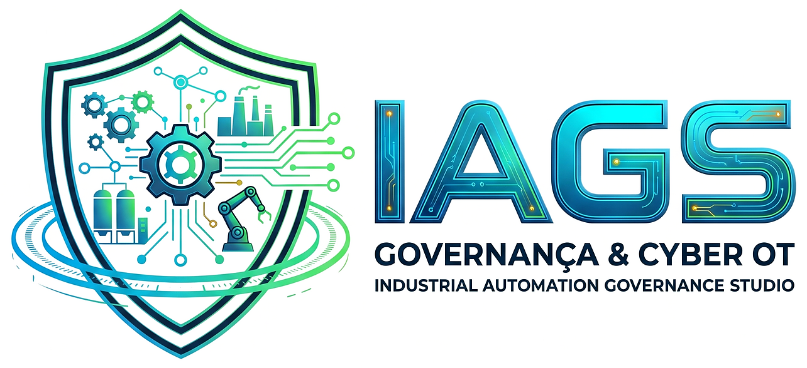
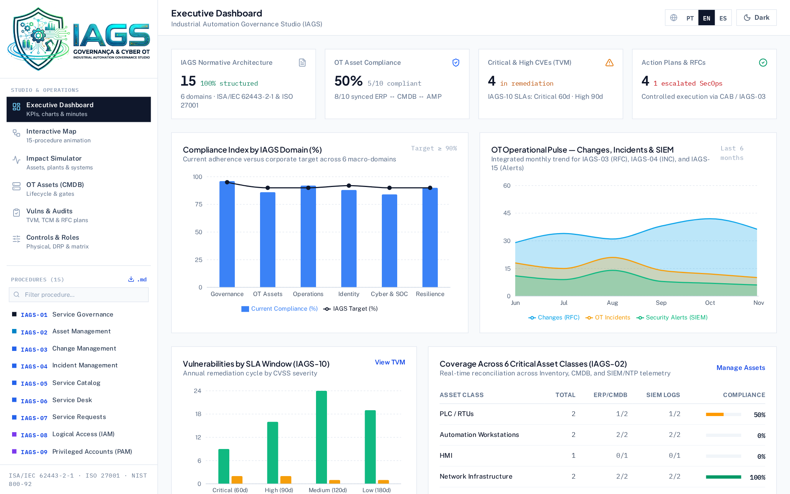
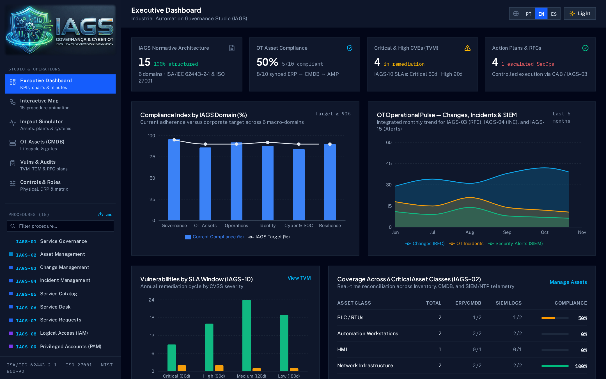
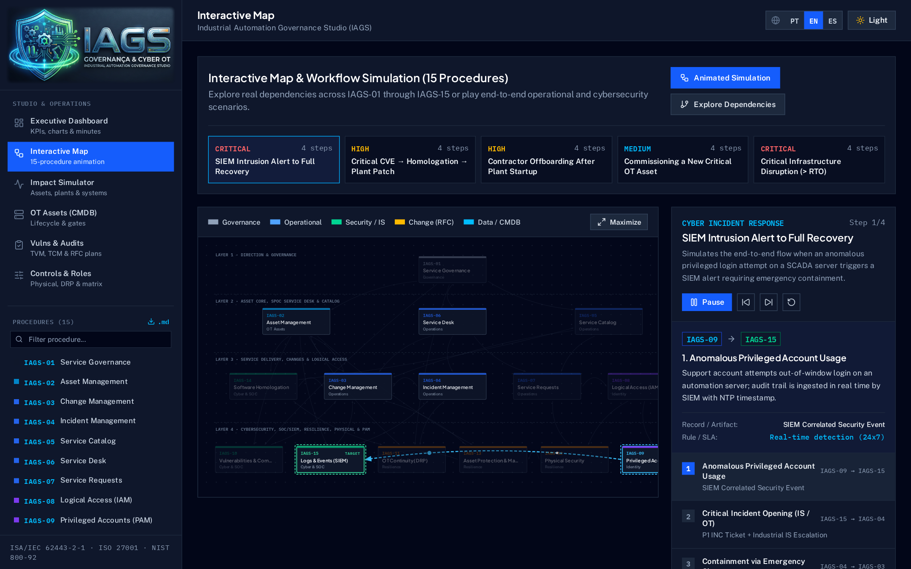
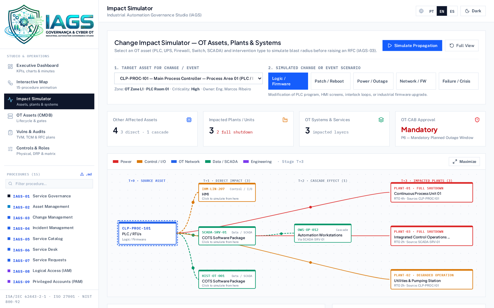
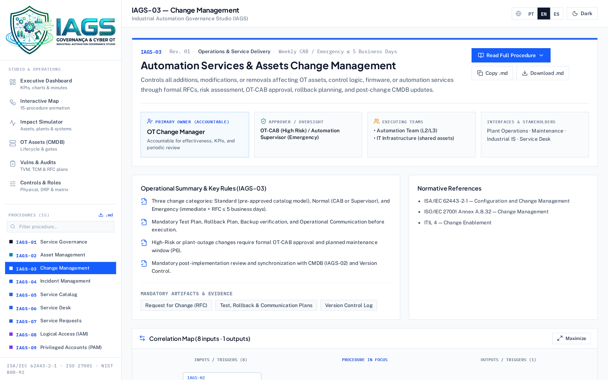
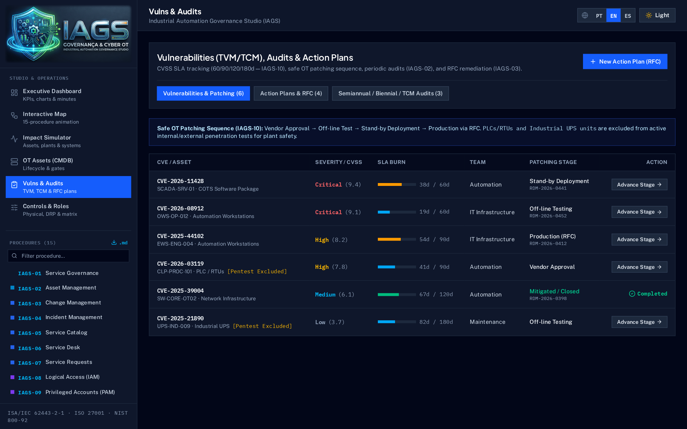

<p align="center">
  <picture>
    <source media="(prefers-color-scheme: dark)" srcset="public/assets/aistudio/iags-logo-banner-dark-v3.png" />
    <source media="(prefers-color-scheme: light)" srcset="public/assets/aistudio/iags-logo-banner-light-v3.png" />
    
  </picture>
</p>

# IAGS — Industrial Automation Governance Studio

**Industrial Automation Governance Studio (IAGS)** is a comprehensive, vendor-agnostic web platform designed to centralize, visualize, simulate, and operationalize **Operational Technology (OT) Cybersecurity and Industrial Automation Service Governance**.

Aligned with **ISA/IEC 62443-2-1**, **ISO/IEC 27001**, **ISO/IEC 20000**, and **ITIL v4**, IAGS transforms static industrial cybersecurity policies into an interactive studio combining real-time governance dashboards, animated procedure-interaction maps, Purdue-model change impact simulation, critical OT asset lifecycle tracking, vulnerability/compliance pipelines, and 15 complete normative procedures ready for audit and export.

---

## Visual Tour & Live Snapshots

### Executive Dashboard — Adaptive Light & Dark Modes
Real-time KPIs across all 15 IAGS procedures, domain adherence vs. target, operational pulse (Changes, OT Incidents & SIEM Alerts), vulnerability SLA windows, and critical asset reconciliation — with instant **PT / EN / ES** language switching and dedicated Light & Dark visual identities for both corporate offices and 24/7 OT control rooms.

| Light Mode | Dark Mode |
| :---: | :---: |
|  |  |

### Interactive Map & Workflow Simulation (15 Procedures)
Explore real upstream/downstream dependencies across `IAGS-01` through `IAGS-15` or play animated end-to-end operational scenarios (such as *SIEM Intrusion Alert to Full Recovery*, *Critical CVE to Plant Patch*, *Contractor Offboarding*, and *Critical Infrastructure Disruption*), complete with fullscreen expansion (`Maximize`).



### Change Impact Simulator — OT Assets, Plants & Systems
Select any target industrial asset (PLC, SCADA, HMI, Historian, Firewall, Industrial Switch, UPS) and proposed intervention (*Logic/Firmware*, *Patch/Reboot*, *Power/Outage*, *Network/FW*, *Failure/Crisis*) to visualize direct and cascading blast radius across connected OT assets, affected industrial plants, RTO targets, and mandatory OT-CAB governance gates before submitting an RFC.



### Dedicated Procedure Workspaces (`IAGS-01` – `IAGS-15`)
Every procedure has its own dedicated view highlighting the **Primary Accountable Owner**, **Approver / Oversight**, **Executing Teams**, **Interfaces & Stakeholders**, operational summary, normative references, interactive **Correlation Map** (clickable inputs/outputs), full normative text reader, and one-click `.md` copy/download.



### Vulnerabilities (TVM/TCM), Safe OT Patching & Audits
Track CVSS remediation SLAs (`60d / 90d / 120d / 180d`), enforce the safe 5-stage OT patching sequence (*Vendor Approval → Off-line Test → Stand-by Deployment → Production via RFC → Mitigated/Closed*), flag safety-excluded PLC/UPS pentest assets, and manage action plans and periodic compliance audits.



---

## Key Benefits of the Tool

### 1. From Static PDFs to Living Governance
Traditional OT cybersecurity procedures live in disconnected documents that engineers rarely consult during day-to-day maintenance or emergencies. IAGS turns all **15 normative procedures (`IAGS-01` through `IAGS-15`)** into interactive modules showing executive summaries, named governance owners, upstream/downstream correlations, and full normative texts in one place.

### 2. Blast-Radius Visibility Before Touching Plant Equipment
Modifying a PLC, SCADA server, industrial switch, or historian without understanding cross-plant dependencies can halt production or compromise safety. The **Change Impact Simulator** models Purdue-level propagation so engineering teams see which assets, industrial plants, supervisory systems, and mandatory governance gates (RDM approvals, homologation, backups, rollback plans) are affected before executing a change.

### 3. Clear Accountability and Audit Readiness
Every procedure explicitly highlights its **Accountable Owner, Supporting Roles, Governance Committee oversight, review cadence, and controlled records**. Combined with interactive audit tracking, corrective action plans, committee minutes, and one-click Markdown exports (single procedure or full 15-procedure compendium), audit preparation time drops dramatically.

### 4. End-to-End Operational Playbook Clarity
The **Process Interaction Studio** animates how governance procedures hand off control during real industrial events—such as critical vulnerability remediation, emergency change requests, cyber incident containment, privileged access sessions, and disaster recovery activation—making cross-team workflows intuitive for both OT engineers and IT/SOC analysts.

### 5. Safe OT Patching & Continuity Discipline
Unlike standard IT patching, industrial environments require strict staging to protect continuous processes. IAGS embeds a 5-stage OT patching workflow (**Vendor Homologation → Off-line Lab Testing → Stand-by Node Application → Production via Change Control → Mitigated/Closed**) alongside RTO/RPO continuity tracking and physical perimeter controls.

### 6. Global, Multi-Team Usability
Built-in **Trilingual Support (Português, English, Español)** switches every menu, chart, simulator node, asset table, normative procedure, and exported Markdown document on the fly, while **Light/Dark Theme Support** and **Fullscreen Graph Expansion** ensure comfortable use in both corporate offices and 24/7 industrial control rooms.

---

## Core Modules & Capabilities

| Module | What It Does |
| :--- | :--- |
| **Executive Dashboard** | High-level KPI overview of OT governance maturity, domain coverage, SLA compliance, vulnerability remediation status, asset criticality breakdown, and interactive analytics charts. |
| **Process Interaction Studio** | Animated network graph illustrating relationships across all 15 IAGS procedures, with selectable operational scenarios (e.g., Cyber Incident Response, Emergency Change, Patch Lifecycle, Access Governance) and fullscreen mode. |
| **Change Impact Simulator** | Interactive industrial topology simulator: select any OT asset (PLC, SCADA, HMI, Historian, Firewall, Industrial Switch, UPS, Safety PLC) and proposed change action to visualize cascading impacts across connected assets, plant areas, safety/availability risk tiers, and required governance checkpoints. |
| **OT Asset Inventory** | Lifecycle management of critical industrial assets with Purdue levels (L0–L4), network zones, criticality tiers, backup/antivirus/EDR posture, filtering, and new asset registration. |
| **Compliance, Vulnerabilities & Audits** | Unified workspace for Technical Vulnerability Management (TVM), 5-stage OT patching progression, technical compliance audits, corrective action plans, physical security perimeters, and critical infrastructure continuity (DRP RTO/RPO targets). |
| **Governance & Roles Matrix** | Centralized governance committee structure, RACI responsibility matrix across automation/cybersecurity/operations roles, and formal committee decision minutes. |
| **15 Individual Procedure Workspaces (`IAGS-01`–`IAGS-15`)** | Dedicated sidebar navigation for every normative procedure featuring: executive summary, key SLA/control metrics, clearly highlighted responsible owners, interactive correlation map linking directly to related procedures, full normative text viewer, and Markdown export. |
| **Fullscreen Graph Expansion** | Every interactive graph, topology, and correlation map includes a one-click maximize/fullscreen frame (`Esc` to exit) for detailed analysis and executive presentations. |
| **Trilingual Engine (`PT` \| `EN` \| `ES`)** | Complete live localization of the UI, data views, charts, simulator outputs, all 15 full normative procedures, and exported Markdown documentation. |
| **Adaptive Light & Dark Modes** | Dedicated high-DPI Light and Dark IAGS visual branding and theme-aware surfaces tailored for both daylight offices and low-light OT control centers. |

---

## Normative Governance Catalog (15 Integrated Procedures)

All procedures are sanitized, standardized, and structured under the **IAGS** framework:

| Code | Procedure Title | Domain |
| :--- | :--- | :--- |
| **IAGS-01** | Automation Service Governance Framework | Governance & Strategy |
| **IAGS-02** | Automation Asset Lifecycle Management | Assets & Configuration |
| **IAGS-03** | Automation Services & Assets Change Management | Service Operations |
| **IAGS-04** | Automation Services & Assets Incident Management | Service Operations |
| **IAGS-05** | Automation Service Catalog Management | Service Operations |
| **IAGS-06** | Automation Service Desk Operations | Service Operations |
| **IAGS-07** | Automation Service Request Management | Service Operations |
| **IAGS-08** | OT Logical Access Management (IAM) | Access & Identity |
| **IAGS-09** | OT Privileged Account Management (PAM) | Access & Identity |
| **IAGS-10** | OT Vulnerability & Technical Compliance Management | Cyber Defense & Compliance |
| **IAGS-11** | Critical Automation Infrastructure Continuity Management | Continuity & Protection |
| **IAGS-12** | OT Physical Security Management | Continuity & Protection |
| **IAGS-13** | Critical Automation Asset Protection & Maintenance | Continuity & Protection |
| **IAGS-14** | OT Software Homologation, Installation & Upgrade | Assets & Configuration |
| **IAGS-15** | OT Asset Logs & Security Events Management | Cyber Defense & Compliance |

---

## Technology Stack

- **Frontend Framework:** React 19 + TypeScript
- **Styling:** Tailwind CSS v4 (`@tailwindcss/vite`) with custom Light/Dark theme variants
- **Data Visualization:** Recharts 3
- **Animations:** Motion (`motion/react`)
- **Icons:** Lucide React
- **Build Tooling:** Vite 8

---

## Project Structure

```text
├── README.md                            # Project documentation & visual tour
├── docs/
│   └── screenshots/                     # Live application snapshots embedded in README
├── index.html                           # Application entry HTML, fonts, and theme-aware icons
├── metadata.json                        # Application metadata
├── public/
│   └── assets/aistudio/                 # High-DPI Light & Dark IAGS brand assets
└── src/
    ├── main.tsx                         # React 19 root mount wrapped in I18nProvider
    ├── App.tsx                          # App shell, navigation sidebar, theme/language switchers, Markdown export
    ├── index.css                        # Tailwind CSS v4 configuration and typography tokens
    ├── components/
    │   ├── IagsLogo.tsx                 # Theme-aware high-DPI IAGS banner & mark component
    │   ├── GraphExpandableFrame.tsx     # Reusable fullscreen expansion wrapper for graphs & maps
    │   ├── OverviewView.tsx             # Executive Dashboard KPIs & charts
    │   ├── InteractionStudioView.tsx    # Animated inter-procedure topology & scenario simulator
    │   ├── ImpactSimulatorView.tsx      # Purdue-layer OT change blast-radius simulator
    │   ├── AssetInventoryView.tsx       # OT asset inventory & lifecycle registry
    │   ├── ComplianceAuditView.tsx      # Vulnerabilities, patching, audits, physical security & DRP
    │   ├── GovernanceMatrixView.tsx     # Committee minutes & RACI governance matrix
    │   └── ProcedureDetailView.tsx      # Dedicated per-procedure summary, owners, correlations & full text
    ├── data/
    │   ├── governanceData.ts            # Operational datasets (assets, CVEs, audits, DRP, minutes, scenarios)
    │   ├── impactTopologyData.ts        # Plant/asset dependency topology & change impact rules
    │   ├── procedureGovernanceDetails.ts# Ownership, roles, and review cadence per procedure
    │   ├── procedures.ts                # Combined 15-procedure catalog & Markdown generators
    │   ├── proceduresPart1.ts           # Normative definitions (IAGS-01 to IAGS-08)
    │   ├── proceduresPart2.ts           # Normative definitions (IAGS-09 to IAGS-15)
    │   └── proceduresTypes.ts           # TypeScript domain interfaces
    └── i18n/
        ├── I18nContext.tsx              # Persistent locale provider (PT | EN | ES)
        ├── uiStrings.ts                 # UI dictionaries & canonical enum translators
        ├── dataTranslations.ts          # Localized datasets, charts & simulation labels
        ├── proceduresEn.ts              # Complete English normative texts (IAGS-01 to IAGS-15)
        ├── proceduresEs.ts              # Complete Spanish normative texts (IAGS-01 to IAGS-15)
        └── procedureLocaleHelper.ts     # Localized procedure selectors & Markdown exporters
```

---

## Getting Started

### Prerequisites
- **Node.js** 20+ and **npm**

### Installation & Local Development

```bash
# Install dependencies
npm install

# Start the development server (runs on http://localhost:3000)
npm run dev
```

### Type Checking & Production Build

```bash
# Run TypeScript type check
npm run lint

# Build production bundle
npm run build

# Preview production build locally
npm run preview
```

---

## Who Is IAGS Built For?

- **OT Cybersecurity Managers & CISOs:** Monitor compliance maturity, remediation SLAs, risk exposure, and audit readiness across industrial sites.
- **Automation & Control Engineers:** Evaluate change blast radius before modifying PLCs/SCADA/network equipment, check required homologation/rollback gates, and consult exact procedure controls instantly.
- **Plant Operations & Maintenance Leaders:** Coordinate maintenance windows, physical perimeter access, service requests, and continuity drills with zero ambiguity.
- **Internal & External Auditors:** Review accountable owners, controlled records, RACI matrices, committee decisions, and export complete localized normative documentation in Markdown format.
